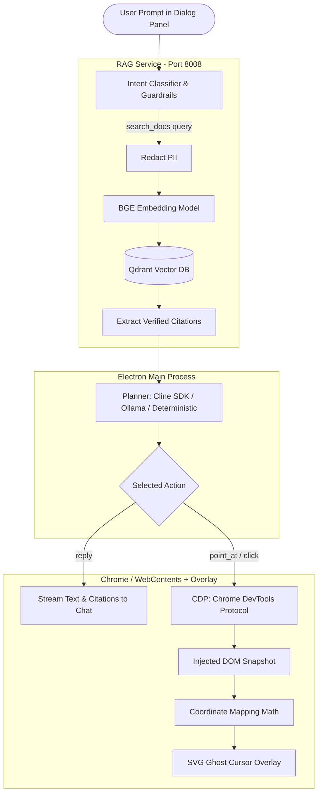

# Ghost Cursor & RAG Architecture & Query Lifecycle

This document breaks down exactly how the product functions end-to-end when a user submits a query, detailing the interplay between **User Intent Classification**, **RAG (Knowledge Retrieval)**, **The Agent Planner**, **Safety Guardrails**, and **The Ghost Cursor (DOM + Overlay Translation)**.

---

## 1. High-Level System Architecture

---

## 2. Complete Step-by-Step Query Lifecycle

When you enter a message in the chat box (e.g., *"How do I register as a new voter?"* or *"Search for voter list"*), the system executes a structured pipeline:

### Step 1: Input Ingestion & Redaction
1. **Chat Panel (`App.tsx`)**:
   The user types into the input box and submits. IPC message `chat:command` (`send`) is emitted to the Electron main process.
2. **PII Redaction (`redact.ts`)**:
   Before anything is processed or logged, sensitive user patterns (Aadhaar numbers, EPIC IDs, phone numbers, emails, passwords) are scrubbed and replaced with `[REDACTED]`.

---

### Step 2: Intent Classification & Mode Selection
The core state machine (`intent.ts` and `stateMachine.ts`) determines what kind of request this is:
* **Guidance Mode (Default)**:
  - The user is asking a question or wanting visual direction.
  - **Rule**: The agent will **only point** and never take control of typing or clicking without explicit permission.
* **Command Mode (`search for <X>`)**:
  - The user explicitly requested an active search.
  - A temporary, single-use **`TypingGrant`** is generated strictly for the search box.

---

### Step 3: RAG Knowledge Retrieval (`search_docs`)
When factual instructions, forms, or rules are needed, the agent invokes the `search_docs` tool (`searchDocs.ts`):

1. **Query Normalization**: The prompt is converted into search terms.
2. **Dense Embeddings (`embed.py`)**:
   The query is encoded via `BAAI/bge-small-en-v1.5` into a dense vector (384 dimensions).
3. **Qdrant Vector Search (`retrieval.py`)**:
   - Queries the Qdrant vector database (`QDRANT_COLLECTION`).
   - Retrieves the top $K$ relevant documentation chunks with similarity scores.
4. **Abstain Check**:
   - If the similarity score is below `ABSTAIN_THRESHOLD` (0.60), the agent **abstains** rather than hallucinating, advising the user to contact the official helpline.
5. **Context Injection**:
   Passing chunks are formatted into `<source id="S1" ...>` blocks and returned to the model as verified reference material.

---

### Step 4: The Agent Perception & Planning Loop
The planner runs a loop: **Perceive $\rightarrow$ Plan $\rightarrow$ Validate $\rightarrow$ Telegraph $\rightarrow$ Act $\rightarrow$ Verify**.

1. **Perceive (Snapshot Extraction)**:
   - Injected script `snapshotScript.ts` walks the DOM in the active browser tab.
   - It queries all interactive nodes (`a[href], button, input, [role="button"]`).
   - For every visible node, it extracts:
     - Ephemeral ID: `data-gc-id="e12"`
     - Element Bounding Box: `{ x, y, width, height }` (in page CSS pixels)
     - Accessible Name / ARIA Label / text preview.
2. **Plan (Model Decision)**:
   The LLM (Cline SDK or local Ollama) selects the single next tool to call:
   - `search_docs`: Query official documentation.
   - `reply`: Give the user grounded guidance in the chat box (citing source IDs like `S1`).
   - `point_at`: Move the ghost cursor to a specific element.
   - `navigate` / `open_tab`: Open an allowlisted URL.
   - `wait_for_user`: Hand control back to the user.
3. **Guardrail Validation (`guardrails.ts`)**:
   - Every tool proposal passes through strict validation.
   - If a URL is not in `ALLOWED_HOSTS` or if the model attempts to type without a valid `TypingGrant`, the action is immediately blocked.

---

### Step 5: Ghost Cursor Calculation & Display
This is the core visual feature: **showing where to click without hijacking the real mouse**.

#### 1. Coordinate Transformation Math (`coordinates.ts`)
The web page DOM coordinates cannot be directly drawn onto the computer screen because of **page zoom, browser navigation bars, and display DPI scaling**.
- **Zoom Factor ($\text{scale}$)**:
  $$\text{scale} = \frac{\text{Chrome window width (DIP)}}{\text{window.innerWidth (CSS px)}}$$
- **Desktop Screen Coordinates**:
  $$\text{screenX} = \text{viewportLeft} + (\text{elementX} \times \text{scale})$$
  $$\text{screenY} = \text{viewportTop} + (\text{elementY} \times \text{scale})$$
- **Overlay Window Translation**:
  $$\text{localOverlayX} = \text{screenX} - \text{displayBounds.x}$$
  $$\text{localOverlayY} = \text{screenY} - \text{displayBounds.y}$$

#### 2. Telegraphing & Bézier Animation
- **Transparent Click-Through Window**: The Ghost Cursor lives in a dedicated, transparent Electron window (`overlayWindow.ts`) with `hasShadow: false`, `alwaysOnTop: true`, and `transparent: true`. It never intercepts real user clicks.
- **Human-Like Curved Movement**: Instead of jumping in a robotic straight line, the ghost cursor animates along a **Quadratic Bézier curve** with an ease-in-out curve over $300\text{–}900\text{ ms}$.
- **Telegraph Banner**: Displays a floating badge over the target element explaining *why* it is pointing there (e.g., *"First, read the official Form 6 guidelines here"*).

---

### Step 6: User Sovereignty & Control
The user's real keyboard and mouse are **never** locked or overridden:
* **The Ghost Cursor Only Guides**: The user manually clicks the highlighted buttons and inputs their own credentials, OTPs, or personal details.
* **Instant Cancellation**:
  - Hitting `Esc` instantly cancels the current ghost movement.
  - Hitting `Double Esc` triggers a hard halt on all automation.
  - Blurring or switching away from the app automatically pauses the ghost cursor until focus returns.

---

## 3. Summary of Roles

| Component | Responsibility |
| :--- | :--- |
| **Chat Renderer (`App.tsx`)** | User interface for inputting queries, viewing streamed answers, and seeing source citations. |
| **RAG Service (`rag/service`)** | Embedding queries, retrieving official chunks from Qdrant, and computing confidence/abstain scores. |
| **Agent Core & Planner** | Deciding the sequence of steps, selecting actions, and managing state transitions. |
| **Guardrails & Typing Grant** | Preventing arbitrary navigation, blocking sensitive field access, and ensuring human-in-the-loop safety. |
| **Browser Bridge (CDP)** | Inspecting the DOM, tracking page events (scroll, click, focus, navigation), and finding elements. |
| **Ghost Cursor Overlay** | Mathematically translating web page coordinates to the desktop screen and drawing an animated guide cursor. |

